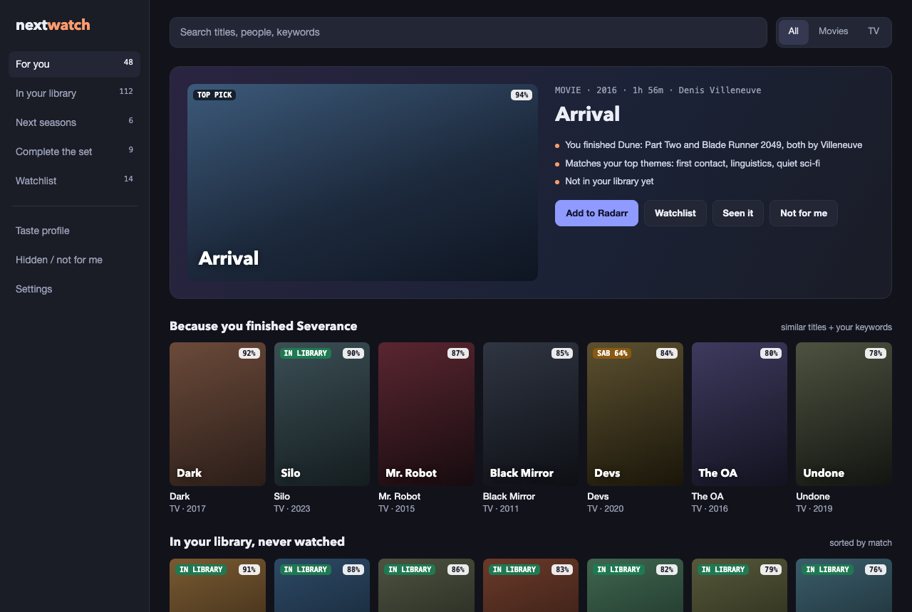
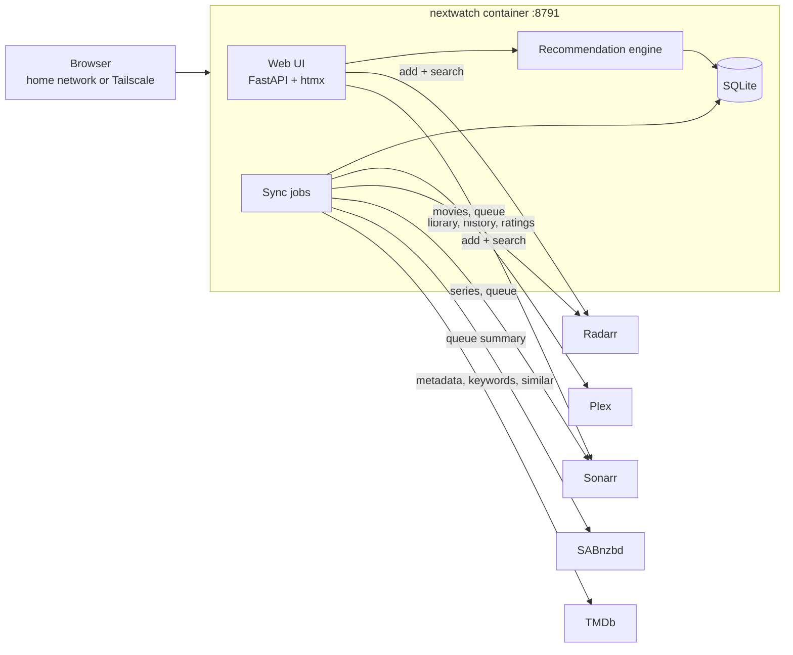

# nextwatch

**Know what to watch next, and why.**

Self-hosted movie and TV recommendations from your own Plex history and library, with one-click add to Radarr and Sonarr.

`In design` · `Python` · `FastAPI` · `SQLite` · `Docker` · `Single user`

Design mockup with example titles. The app is not built yet.

## What it is

A small web app for a home server. It learns your taste from your Plex watch history, looks through what is already in Radarr and Sonarr, and suggests what to watch or add. Every pick shows why it was chosen. It is for one person browsing their own library, not a request portal for a household.

Trakt-style tools focus on tracking and scrobbling. Nextwatch focuses on the next pick.

## Planned features

- **Explained picks.** "You finished Dune: Part Two and Blade Runner 2049." Reasons come from the score, never invented.
- **Real history from day one.** Uses Plex play counts, completion, ratings and recency. No extra tracking service.
- **Library-aware rows.** For you, Because you finished X, In your library but unwatched, Next seasons, Complete the set (films missing from a collection you started), Directors and actors you binge, Outside your usual.
- **One-click add.** Sends a title to Radarr or Sonarr with your quality profile and root folder, starts the search, and shows download progress from their queues.
- **Feedback that counts.** Not for me, Seen it, Watchlist and thumbs up change the next scores. A taste profile page shows what it learned, and the score weights are adjustable.
- **Light and private.** One container, one SQLite file, no cloud service. Under 256 MB of RAM.
- **Reach it anywhere you trust.** Home network, or over Tailscale. No public port.

Not in version 1: other household users, streaming-service availability, Trakt import, notifications, auto-adding without a click, AI features (a provider hook is designed in for later).

## How it works

Nextwatch never talks to your indexer or usenet provider. Radarr and Sonarr already own that.

**Scoring.** Each watched title gets a weight from completion, rating and recency (half-life 180 days). Genres, keywords, directors, cast and decades are summed into a taste profile. Candidates come from TMDb recommendations for your top titles, TMDb discovery by your top keywords and people, and unwatched titles you already own. Each is scored on taste match (55%), how many of your favourites point to it (20%), quality (15%) and freshness (10%), then re-ranked for variety.

## How it compares

| Tool | Good at | Gap Nextwatch aims to fill |
|---|---|---|
| [Diskovarr](https://github.com/Lebbitheplow/diskovarr) | Multi-user request portal with recommendations | Learns from Tautulli history only; no next-seasons or collection-gap rows |
| [SuggestArr](https://giuseppe99barchetta.github.io/SuggestArr) | Auto-requests similar titles | Acts for you rather than letting you browse and choose |
| [Shortlist](https://github.com/stevezau/shortlist) | Per-user rows inside Plex | No separate browsing page with reasons |
| Trakt | Tracking and scrobbling | Library-aware picks are not its focus |

If one of these already does what you need, use it.

## Status

In design. Done: research, mockup, architecture, scoring design and a 25-task build plan. Not started: code. The build is planned as a loop of small tasks run by cheaper models, each checked by an automated test gate, with a person needed at only a few checkpoints.

A static landing page lives in [`docs/index.html`](docs/index.html).

## Planned setup

Everything is configured with environment variables: addresses and API keys for Plex, Radarr, Sonarr and SABnzbd, plus a free TMDb API key. Build and deploy scripts will ship with the first release.

## Credits

This product uses the TMDb API but is not endorsed or certified by TMDb. Not affiliated with Plex, Radarr, Sonarr or SABnzbd.
